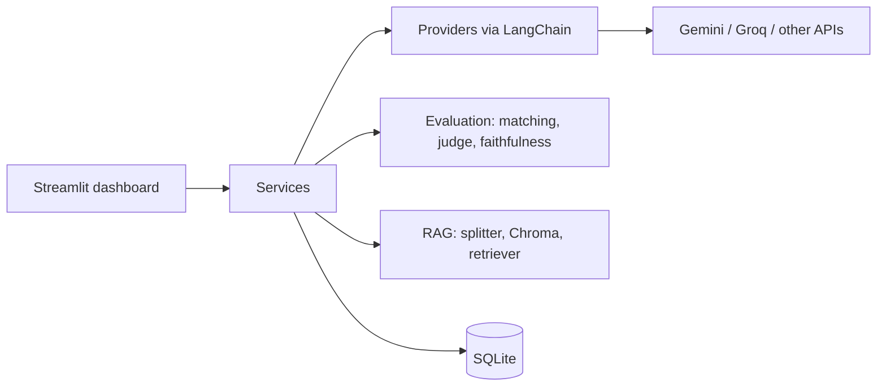

# LLM EvalLab

A small tool I built to compare language models on my own questions, check how good their answers really are, and test different RAG setups.


## Why I built this

People say "model A is better than model B" all the time, and I wanted to know how that actually gets measured. So I started simple: send the same questions to two models and count the right answers.

That fell apart quickly. If the expected answer is `Mahatma Gandhi` and the model says `Gandhi ji`, string matching calls it wrong. So I added a second model that grades the answers, and then I had to check whether that grader could be trusted. After that I added RAG, because I wanted to see for myself how much it helps when the model has never seen the facts.

This project is what came out of that.

## What it does

- Upload a CSV or JSONL file with questions and expected answers.
- Run the same questions on several models. Gemini and Groq are built in, and you can add any other model with an OpenAI-compatible API from the dashboard (OpenRouter, DeepSeek, a local Ollama, and so on).
- Score every answer three ways: string matching, an LLM judge (1 to 5 with a short reason), and latency / tokens / estimated cost.
- Check the judge itself against answers I graded by hand.
- RAG lab: load a document, try different chunk sizes and top-k values, and compare the same model with and without RAG. It also checks faithfulness, meaning whether an answer is actually supported by the chunks the model was given.
- Everything is saved in SQLite, so I can go back to old experiments.

| | |
|---|---|
|  |  |

## What I found

Benchmark: 27 hand-written questions (arithmetic, letter counting, a few obscure facts, two trick questions with a false premise), every question sent one call at a time.

[Paste the table from `python make_report.py` here]

A few things worth saying in plain words:

- **String matching undercounts.** It marked [K] answers wrong that the judge accepted, for example [question, expected answer, what the model said]. The judge is not perfect either, but it is closer to how a person would grade.
- **How much I trust the judge.** On [15] answers I graded by hand, the judge agreed with me [N] times. String matching agreed [N] times.
- **[Model A] vs [Model B].** [One honest sentence. If they came out about equal, say that. It is a real result.]
- **Cost and speed.** [Model A] costs about $[X] per 1,000 questions and answers in about [Y] seconds on average. [Model B]: $[X] and [Y] seconds.

RAG, on a made-up company handbook (17 questions). I wrote the handbook myself so the models could not know any of it:

| | Accuracy (string match) | Faithful answers |
|---|---|---|
| [Model] without RAG | XX% | not applicable |
| [Model] with RAG | XX% | XX/XX |

Without RAG the model just guessed. It said things like "founded in 2015" and "9 AM to 5 PM" about a company that does not exist. With RAG it answered from the document. For retrieval, chunk size 150 missed some answers because they got split across chunks, while 300 and 600 found all of them.

## How it works



LangChain handles the model calls, the text splitter, the Chroma vector store and the retriever. The parts I wrote myself are the scoring (matching and the judge's rubric), validating the judge's JSON with Pydantic, the cost estimate, retrieval hit rate, faithfulness, and the database layer. I kept those on purpose, because I wanted to understand how the scores are produced instead of handing that to a framework.

Small design choices that might look odd:

- The judge must return JSON. I validate it with Pydantic, retry once if the format is wrong, and never retry on quota errors (a retry would just burn more quota).
- Batch mode sends 10 questions in one call. It uses far fewer API calls, but latency and tokens then become estimates, so I used one call per question for the final numbers.
- Failed API calls are stored as errors and are not counted as wrong answers. If a run has errors, I do not compare its accuracy.

## Run it yourself

I used Python 3.12. When I tried the newest Python, some packages had no prebuilt wheels and the install failed.

```bash
git clone <your-repo-url>
cd llm-evallab/backend
python -m venv venv
venv\Scripts\activate          # Mac/Linux: source venv/bin/activate
pip install -r requirements.txt
cp .env.example .env           # then add your keys
pytest
streamlit run dashboard.py
```

`.env` needs `GEMINI_API_KEY`, `GEMINI_MODEL`, `GROQ_API_KEY` and `GROQ_MODEL`. Both providers have free tiers, but with low limits, so keep the question count small while you try things out. The first time you open the RAG lab it downloads a small embedding model (about 80 MB), once.

The tests use fake models and a fake embedding, so `pytest` makes no API calls. The dashboard pages are tested with Streamlit's AppTest.

Some scripts I use from the terminal:

```bash
python history.py              # list saved experiments
python make_report.py 9 10     # markdown tables for the README
python fix_costs.py <model> <price_in> <price_out>   # recompute saved costs after fixing a price
```

## Project layout

```
backend/
  dashboard.py          the Streamlit app
  app/
    providers/          model calls (LangChain) and the model registry
    evaluation/         string matching, LLM judge, faithfulness, metrics
    rag/                loader, chunker, Chroma store, retrieval metrics
    services/           experiment runner, judging, reports, RAG experiments
    db/                 SQLite tables and queries
  tests/
data/
  harder_questions.csv, rag_questions.csv, documents/, validation files
```

## Things that went wrong

- **Free tier limits.** Gemini sometimes answered with a 503 or a quota error. At first those counted as wrong answers and made one model look worse than it was. Now errors are stored separately and shown in their own column.
- **A model disappeared.** Groq removed the model I had set up and every call returned 404. Model ids now live in `.env`, and I check what is available before blaming my own code.
- **Two models with the same cost.** My table showed identical costs for two very different models. The cause was a wrong price I had typed in for one of them. Cost is only as good as the price you enter, so I added a script to recompute saved costs.

## Limits of this project

- The datasets are small (27 and 17 questions), so treat the numbers as a demo, not a leaderboard.
- The judge and one of the models come from the same provider, which can favour its own style of answer. You can choose any model as the judge in the dashboard.
- Retrieval hit rate only checks that the expected text appears in the chunks. It works for short factual answers, not for long free-text ones.
- Costs are estimates based on list prices, not what I was actually billed on a free tier.
- One user, one local database. There is no login.

## What I would do next

- Pairwise comparison (show the judge two answers in random order) to measure position bias.
- Regression tests that flag when a new prompt does worse than the old one.
- Cache answers so the same question is not sent twice, and run calls in parallel.
- A React front end on top of a FastAPI API.

Built by Himanshu.
